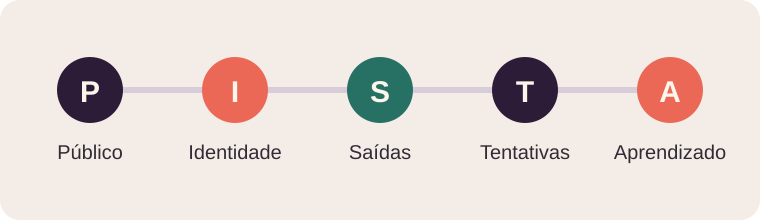

# Comece pelo que você já tem

## Este guia é para você

Você tem uma música gravada ou perto da versão final. Quer lançar com cuidado, mas talvez não tenha equipe, verba de divulgação ou uma audiência grande. Este livro foi pensado para esse ponto de partida.

O objetivo é ajudar você a sair de uma faixa pronta e chegar a um lançamento publicado, apresentado às pessoas certas e revisto com atenção ao que aconteceu. Você vai organizar o trabalho em passos pequenos: preparar, contar, convidar, conversar e aprender.

Não existe promessa honesta de streams, viralização, playlist, shows ou renda. Esses são limites importantes do que um método pode afirmar. O que existe é um processo que você consegue executar, observar e melhorar.

## A ideia central: PISTA

PISTA é o mapa deste livro. Não é fórmula de algoritmo nem método comprovado em ensaio controlado. É uma maneira simples de não perder de vista as decisões importantes.

1. **Público:** escolha uma situação e um grupo de ouvintes para quem a música pode fazer sentido.
2. **Identidade:** apresente a faixa com uma frase verdadeira, um trecho marcante e uma linguagem visual coerente.
3. **Saídas:** facilite o caminho entre descobrir a música, ouvi-la inteira e encontrar você de novo.
4. **Tentativas:** publique apresentações diferentes, converse e colabore quando houver afinidade.
5. **Aprendizado:** anote de onde veio o interesse e o que vale repetir, ajustar ou testar.

O percurso não precisa ser perfeito. Precisa estar claro o bastante para você começar e simples o bastante para continuar. Ao terminar cada etapa, escolha o próximo passo concreto.

## O que este livro pede de você

Você não precisa publicar todos os dias nem estar em todas as plataformas. Precisa reservar algum tempo, saber quais direitos e recursos estão disponíveis e fazer convites honestos. Se uma ferramenta não ajuda o próximo passo do ouvinte, deixe-a de lado.

Ao longo do guia, separamos fatos documentados sobre plataformas, relatos de artistas e recomendações que ainda precisam ser testadas. Um exemplo hipotético serve para ilustrar uma decisão; não é prova de resultado.

## Seu primeiro passo

Abra uma nota e escreva, sem tentar deixar bonito:

- Qual música quero lançar?
- Para quem ela pode fazer sentido?
- O que consigo fazer por semana?
- Qual é meu limite de gasto?
- O que já tenho: faixa, arte, perfil, contatos, equipamento ou ajuda?

**Feito é melhor que perfeito:** uma resposta concreta agora ajuda mais do que um plano genérico para um futuro ideal.

## Abençoar também é dar clareza

Seu trabalho merece cuidado, e você também. O valor de um lançamento não cabe em um contador de plays. Uma conversa sincera, uma pessoa que volta para ouvir, uma parceria ou uma decisão melhor para a próxima faixa também são sinais que vale registrar.

Siga no seu ritmo. Use este guia como apoio, não como cobrança. O próximo capítulo ajuda a transformar a música e as suas condições reais em um plano possível.
